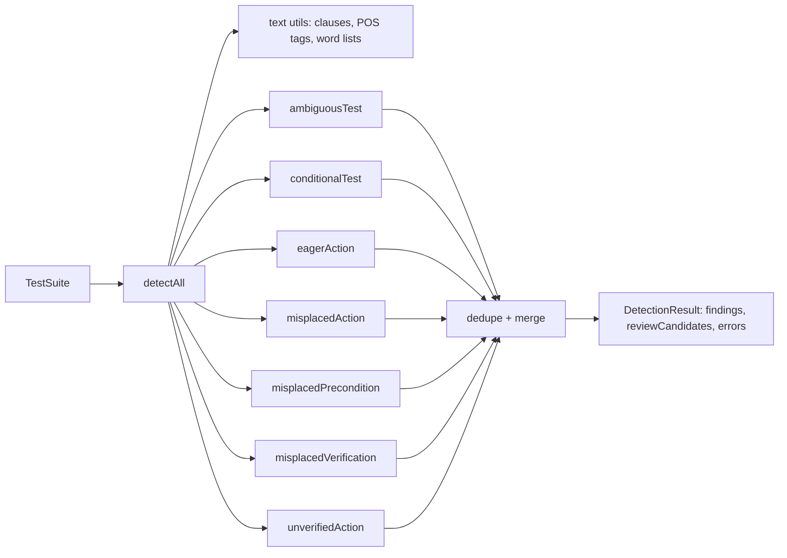

# Design Document

## Overview

The smell detector is a set of seven pure, synchronous detector functions plus an orchestrator (`detectAll`). Detectors share a small text-analysis layer built on the `compromise` NLP library and on word lists taken from `docs/smells.md`. Each detector returns findings (confident) and review candidates (uncertain). The orchestrator runs every detector on every step, removes duplicates and returns one `DetectionResult`.

Design goals: explainable rules, no network, fast enough to run on every file save, and an output shape that the LLM reviewer, fixer, scorer, CLI, MCP server and web app can all consume unchanged.

## Architecture



## Components and Interfaces

### Detector contract

```ts
interface DetectorContext {
  testCase: TestCase
  step: Step
  isFirstStep: boolean
}

interface DetectorOutput {
  findings: Finding[]
  reviewCandidates: ReviewCandidate[]
}

type Detector = (ctx: DetectorContext) => DetectorOutput
```

Each detector file exports one `Detector` and a `meta` object (`smellName`, `ghostName`, `fixName`) read from a single constants file that mirrors `docs/smells.md`.

### Text utilities (`src/text/`)

| Function | Purpose |
|---|---|
| `splitClauses(text)` | Split on sentence ends, commas before verbs, "and", "then", ";" |
| `tag(text)` | Wrap `compromise` and return tokens with tags and character offsets |
| `isImperativeStart(clause)` | First token is a base-form verb (not a modal or auxiliary) |
| `findWords(text, list)` | Case-insensitive whole-word matches with offsets |
| `wordLists` | Vague words, verification verbs, prerequisite words, outcome words, subordinating conjunctions |

Note for implementation: confirm the exact `compromise` tag names (e.g. `#Verb`, `#Infinitive`, `#Adverb`, `#Comparative`, `#Superlative`, `#Determiner`, `#Pronoun`, `#Auxiliary`, `#Participle`) against the library documentation, and cover every rule with unit tests rather than relying on tags alone.

### Detector rules

| Detector | Field(s) | Confident finding | Review candidate |
|---|---|---|---|
| `ambiguousTest` | action, verification | Vague-word list match | POS-only match: verb + indefinite determiner, indefinite pronoun, comparative/superlative adjective, manner adverb, comparative adverb |
| `conditionalTest` | action, verification | if, whether, unless, otherwise, in case, depending on | "when" without a following condition clause |
| `eagerAction` | action | ≥ 2 clauses starting with an imperative verb | 2 verbs found but clause split unclear |
| `misplacedAction` | verification | Clause starts with an imperative verb not in the verification-verb list | Starts with an ambiguous verb that can be a noun (e.g. "Set", "Close") |
| `misplacedPrecondition` | action of first step | Subject + auxiliary + past participle; prerequisite words; OR "make sure"/"ensure that" + state description in the first step | State-like sentence without a clear participle |
| `misplacedVerification` | action | Verification verb anywhere (except "make sure"/"ensure that" + state description in the first step), or "should" / "must be displayed" | — |
| `unverifiedAction` | verification | No non-empty verification → `severity: "normal"`; navigation verb (open, go to, navigate to, launch, start, switch to, return to, scroll to) + next step has ≥1 verification → `severity: "low"` | — |

Keyword ownership follows `docs/smells.md`: verification verbs belong only to `misplacedVerification` (and are the exclusion list for `misplacedAction`); subordinating conjunctions belong only to `conditionalTest`; state descriptions only to `misplacedPrecondition`.

### Orchestrator (`src/detectors/index.ts`)

```ts
function detectAll(suite: TestSuite): DetectionResult
function detectSmell(smell: SmellName, suite: TestSuite): DetectionResult
```

Steps: iterate test cases and steps → run each detector inside `try/catch` (record errors, continue) → dedupe findings by `caseId|stepIndex|field|smellName` → drop review candidates that duplicate a finding → sort by case, step, smell.

## Data Models

```ts
type SmellName =
  | 'AmbiguousTest' | 'ConditionalTest' | 'EagerAction' | 'MisplacedAction'
  | 'MisplacedPrecondition' | 'MisplacedVerification' | 'UnverifiedAction'

type FixName =
  | 'ExtractAmbiguity' | 'ExtractConditional' | 'SeparateActions' | 'ExtractAction'
  | 'ExtractPrecondition' | 'ExtractVerification' | 'FillVerification'

interface TestSuite { id: string; name: string; cases: TestCase[] }
interface TestCase { id: string; title: string; preconditions: string[]; steps: Step[] }
interface Step {
  index: number
  action: string
  verifications: string[]
  source?: { file?: string; row?: number; line?: number }
}

interface Finding {
  caseId: string
  stepIndex: number
  field: 'action' | 'verification' | 'precondition'
  verificationIndex?: number
  span?: { start: number; end: number }
  smellName: SmellName
  ghostName: string
  reason: string
  confidence: 'rule' | 'llm' | 'hybrid'
  fixName: FixName
}

interface ReviewCandidate {
  caseId: string
  stepIndex: number
  smellName: SmellName
  field?: 'action' | 'verification' | 'precondition'
  verificationIndex?: number
  hint: string
}

interface DetectionResult {
  findings: Finding[]
  reviewCandidates: ReviewCandidate[]
  errors: { detector: SmellName; caseId: string; stepIndex: number; message: string }[]
}
```

## Error Handling

- Detectors never throw on unusual text (empty strings, emojis, very long steps); unexpected exceptions are caught by the orchestrator and recorded in `errors`.
- Invalid input shapes are the importers' responsibility; the detector assumes a valid `TestSuite` and validates only that `steps` and `verifications` are arrays.

## Testing Strategy

- **Unit tests per detector** (`tests/detectors/<name>.test.ts`): the smelly and clean examples from `docs/smells.md`, plus edge cases (empty text, punctuation only, mixed case).
- **Ownership test:** a step containing only "Verify the total is 100" yields Misplaced Verification and not Misplaced Action or Ambiguous Test.
- **Integration test:** a fixture suite with one case per smell and one fully clean case; assert exact findings.
- **Ubuntu-style fixture:** a few public-style steps reproducing the paper examples ("Open any application and suspend machine", "If you have a USB drive, plug it in", "Close flip and check app continuity", "The monitor is not connected, and the PC is not paired").
- **Performance test:** 1,000 generated steps under 500 ms.
- Benchmark accuracy (precision/recall/F1) is measured later in the `benchmark` spec.
