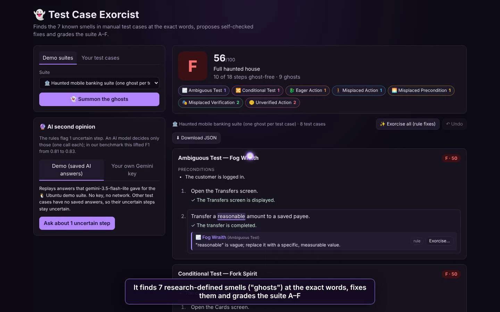
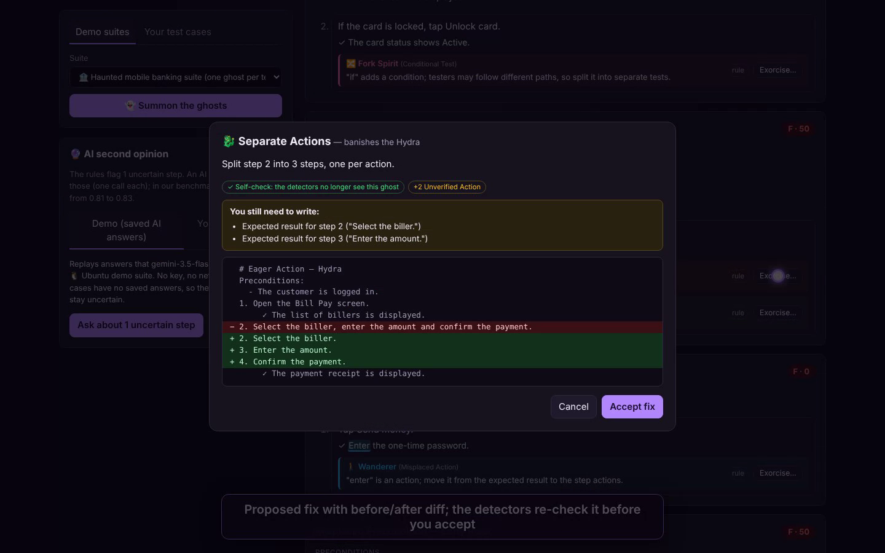

# Test Case Exorcist 👻

> **A linter for manual test cases.** It finds the 7 research-defined smells ("ghosts") in hand-written test steps at the exact words, proposes fixes it checks itself, and grades the suite A–F.
> A Kiroween 2026 entry, built with [Kiro](https://kiro.dev).

**▶ Live demo:** https://rimshafayyaz.github.io/test-case-exorcist/
**🎬 Video (3 min):** [docs/media/demo.mp4](docs/media/demo.mp4)

[](docs/media/demo.mp4)

---

## Why

Manual test cases are written by hand, and more and more by AI test generators. A 2026 study of the public Ubuntu manual test suite found that **58.56% of test steps contain at least one natural-language test smell** ([arXiv 2606.13804](https://arxiv.org/abs/2606.13804)). Typical problems are vague words, several actions in one step, hidden preconditions and steps with no expected result. When a test case can be read two ways, two testers run two different tests, and bugs slip through.

Researchers have catalogued these smells since 2013, but QA teams still have no easy tool for them. Test Case Exorcist turns that research into one.

### Why not just paste the test cases into ChatGPT or Gemini?

A large model is more accurate on nuance (see the benchmark below), and for five test cases that is fine. This tool is built for the cases where a chat window does not work:

| | Chat AI | Test Case Exorcist |
|---|---|---|
| Private test cases | Sent to a provider | Rules run fully in your browser; nothing is uploaded |
| Same input, same result | No | Yes, so a grade can be a team quality bar |
| A suite with thousands of steps | Rate limits and cost | 1,000 steps in about 0.5 s, free |
| Where it runs | Copy and paste | Web app today; CLI, MCP server and Kiro hook planned |
| AI use | Every step | Only the steps the rules are unsure about (8 calls on the study sample) |

## The 7 ghosts

| Smell | Ghost | Example | Automatic fix |
|---|---|---|---|
| Ambiguous Test | 🌫️ Fog Wraith | "Transfer a **reasonable** amount." | Needs a human or the AI: only they know the right value |
| Conditional Test | 🔀 Fork Spirit | "**If** the card is locked, tap Unlock." | Split into two test cases |
| Eager Action | 🐉 Hydra | "Select the biller, enter the amount **and** confirm." | One action per step |
| Misplaced Action | 🚶 Wanderer | Expected result: "**Enter** the one-time password." | Move the action into a new step |
| Misplaced Precondition | 🌅 Early Riser | Step 1: "The card **is not activated**." | Move it to the preconditions |
| Misplaced Verification | 🎭 Mixed Soul | Step: "**Verify** that the statement is listed." | Move it to the expected result |
| Unverified Action | 🤫 Silent Ghost | "Tap Download statement." with no expected result | Add a TODO placeholder for the tester |

Full definitions, detection rules and examples are in the [smell catalog](docs/smells.md).

## What it does



- **Finds each ghost at the exact words** and explains it in one sentence.
- **Grades the suite A–F.** Score = 100 × (1 − steps with a ghost ÷ all steps); a "low" finding counts ¼. A ≥ 90, B ≥ 80, C ≥ 70, D ≥ 60, otherwise F.
- **Proposes fixes as a before/after diff.** Before showing a fix, the detectors run again on the result (a self-check), and the dialog lists anything the tester still has to write.
- **Exorcise all:** applies every safe rule-based fix in one click, with Undo.
- **Imports your test cases** as pasted text (numbered steps), CSV, Excel (.xlsx) or JSON, and downloads the cleaned suite as JSON.
- **AI second opinion (optional).** The rules mark uncertain steps; only those are sent to an AI model.
  - **Demo mode** replays saved Gemini answers, with no key and no network.
  - **Your own Gemini key** calls Google directly from your browser. The key stays in your browser; this site has no server.

## How to use it

1. Open the [live demo](https://rimshafayyaz.github.io/test-case-exorcist/). It loads a haunted mobile-banking suite.
2. Click a smell chip to filter, or **Exorcise…** on a ghost to see its fix, then **Accept fix**.
3. To check your own test cases, open **Your test cases**, choose the format, then paste them or open a file and click **Find the ghosts**.
4. Fix what you can, fill in the TODO expected results, then **Download JSON**.
5. Run your manual tests as usual, now with steps that can only be read one way.

The tool checks how test cases are **written**. It does not run them against your application.

Sample files to try: [`datasets/samples/fintech/`](datasets/samples/fintech) (card management as text, payments as JSON, account opening as CSV). All sample data is synthetic.

## Benchmark

On the human-labelled sample of the 2026 study (103 labelled items in 14 Ubuntu test cases, [Zenodo, CC BY 4.0](https://doi.org/10.5281/zenodo.20549059)), micro F1 per label:

| Detector | Precision | Recall | F1 |
|---|---|---|---|
| **Test Case Exorcist, rules only** (offline, about 0.2 s) | 0.93 | 0.73 | **0.82** |
| Rules + Gemini 3.5 Flash-Lite on the 8 uncertain steps | | | **0.83** ¹ |
| Gemini 3 (from the study) | 0.92 | 0.91 | 0.91 |
| GPT-5.2 (published) | | | 0.82 |
| Manual Test Sensei, the earlier rule-based tool (published) | | | 0.66 |

¹ Measured with the previous rule version (rules 0.81 → 0.83).

**Held-out check:** the rules were tuned only on half of 80 unseen study test cases (scored against Gemini 3's outputs). On the other half, the rules score 0.81, and 0.83 with the AI reviewer. The weakest smell is Ambiguous Test (F1 about 0.5–0.6). Details and every disagreement: [bench/README.md](bench/README.md) and [bench/results/](bench/results).

```bash
pnpm bench            # rules on the labelled sample
pnpm bench:heldout    # dev/test split on unseen cases
pnpm bench:llm        # with the Gemini reviewer (needs GEMINI_API_KEY)
```

## Run it locally

Requires Node 20+ and pnpm.

```bash
pnpm install
pnpm --filter @exorcist/core test     # about 550 tests, including property-based tests
pnpm --filter @exorcist/web dev       # web app at http://localhost:5173/test-case-exorcist/
```

## How it is built

```
packages/core     TypeScript library: detectors, scorer, fixers, importers, LLM reviewer
apps/web          React + Vite web app (deployed to GitHub Pages by .github/workflows/pages.yml)
bench/            benchmark scripts and results
datasets/         study sample (CC BY 4.0) and synthetic fintech samples
.kiro/            steering and specs (requirements, design, tasks) for each part
docs/             brief, smell catalog, architecture, Kiro log
```

- **Detection:** the 7 detectors use part-of-speech tagging ([compromise](https://github.com/spencermountain/compromise)) and word lists from the research catalog. Each returns sure findings plus uncertain "review candidates".
- **Hybrid AI:** only review candidates go to the model, as one short JSON question each. Answers are cached, so the same question is never paid for twice.
- **Fixes:** pure functions. A property-based test suite (fast-check) checks that every fix removes its smell without adding others.

## How Kiro was used

- **Steering** (`.kiro/steering/`): product rules, tech stack, repo structure and the testing-domain rules (data policy, accuracy targets).
- **Specs** (`.kiro/specs/`): requirements, design and task lists for the smell detector, scorer, fixer, LLM reviewer and importers. Every task is ticked off as it is built.
- **Implementation and review:** Kiro set up the workspace, built the first parts (data models, text utilities, the first detectors) and reviewed the later detector tasks against the spec. Much of the later code (scorer, fixers, importers, LLM reviewer, web app) was written with another AI coding assistant, working from these Kiro specs and task lists.

Session-by-session notes are in the [Kiro log](docs/kiro-log.md).

## Roadmap

- [x] Detectors, scorer, fixers, importers, LLM reviewer, benchmark
- [x] Web app on GitHub Pages
- [ ] CLI quality gate for CI (fail a pull request below a grade)
- [ ] Kiro hook: re-check a test file on save
- [ ] MCP server so AI agents can use the checker
- [ ] Import one-row-per-test-case spreadsheets (all steps in one cell)
- [ ] "Fix all" with AI-drafted expected results marked for review

## Data and credits

- Smell definitions: *Manual Tests Do Smell!* (2023), the transformation catalog (2024) and the 2026 Ubuntu study.
- Study sample: Zenodo [10.5281/zenodo.20549059](https://doi.org/10.5281/zenodo.20549059), CC BY 4.0. Attribution is in [datasets/benchmark/README.md](datasets/benchmark/README.md).
- All fintech examples are synthetic and describe a generic mobile-banking app.

## License

[MIT](LICENSE)
