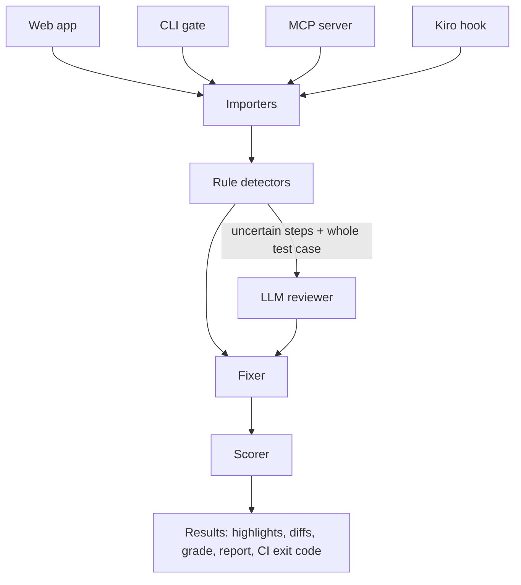

# Architecture

Test Case Exorcist has one core engine (`@exorcist/core`) used by four entry points: the web app, the CLI gate, the MCP server and Kiro hooks. A smell is therefore detected the same way in the browser, in CI and by AI agents.



## Components

| Component | Location | Responsibility |
|---|---|---|
| Models | `packages/core/src/models/` | `TestSuite`, `TestCase`, `Step`, `Finding`, `Fix` |
| Importers | `packages/core/src/importers/` | Paste text, CSV, Excel, Gherkin, Ubuntu `<dl>/<dt>/<dd>` → `TestSuite` |
| Rule detectors | `packages/core/src/detectors/` | One file per smell, synchronous, no network; rules from `docs/smells.md` |
| LLM reviewer | `packages/core/src/llm/` | Confirms uncertain findings and Ambiguous Test; receives the whole test case; JSON validated with zod; cached by hash |
| Fixer | `packages/core/src/fixers/` | One transformation per smell (Extract Conditional, Separate Actions, …); returns before/after, never mutates input |
| Scorer | `packages/core/src/scorer/` | Smell density, counts per smell, grade A–F, Markdown report |
| CLI | `packages/cli/` | `exorcist check` (non-zero exit over threshold), `exorcist fix` |
| MCP server | `packages/mcp/` | Tools `detect_smells`, `fix_step`, `score_suite`; smell catalog as a resource |
| Web app | `apps/web/` | Upload/paste, highlights, diff review, grade, export; server route for LLM calls only |

## Data model

```ts
interface TestCase { id: string; title: string; preconditions: string[]; steps: Step[] }
interface Step { index: number; action: string; verifications: string[]; source?: { file?: string; row?: number; line?: number } }
interface Finding {
  caseId: string; stepIndex: number;
  field: 'action' | 'verification' | 'precondition';
  smellName: SmellName; ghostName: string; reason: string;
  confidence: 'rule' | 'llm' | 'hybrid';
  fixName: FixName;
}
```

## Key decisions

| Decision | Reason |
|---|---|
| Rules before LLM | Fast, free, explainable; the 2026 study found rules and LLMs complementary |
| LLM sees the whole test case | 2025 SLM study: models miss Misplaced Action/Verification/Precondition when given one sentence |
| Fixes are diffs needing approval | Fixes must not change testing intent; the tester stays in control |
| One core for all entry points | Same results in browser, CI and agents; one place to test |
| No keyword shared by two detectors | Avoids double-flagging the same words (see `docs/smells.md`) |
| Public/synthetic data only | Open benchmark and no confidential data |
