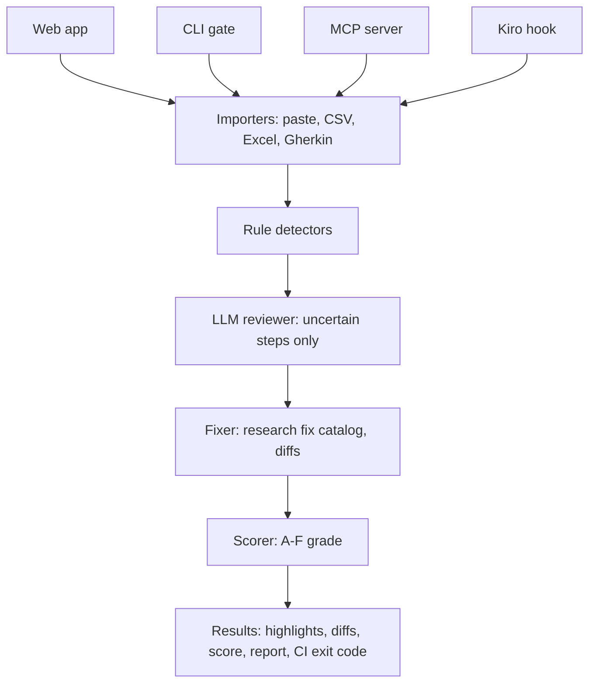

# Test Case Exorcist — Project Brief

Test Case Exorcist finds and fixes "smells" in manual test cases at the exact step, using the published research catalog of natural-language test smells. It offers one-click fixes shown as diffs, a suite score, measured accuracy, and works from a web app, a CLI quality gate, an MCP server and Kiro hooks.

Built for Kiroween 2026.

---

## Problem

Manual test cases are written by hand, and more and more by AI test generators. Steps are often vague, pack several actions together, hide preconditions, or have no expected result. A 2026 study of the public Ubuntu manual test suite found that **58.56% of test steps contain at least one smell**, and its authors note that "existing automated support remains limited."

Research prototypes exist, but there is no maintained, easy-to-use tool that detects these smells at step level, fixes them, and proves how accurate it is.

## Users

- Manual QA engineers writing and reviewing test cases
- QA leads reviewing large suites
- Teams using AI to generate test cases
- Students learning test design

## Principles

- Every finding points to an exact step and gives a one-sentence reason.
- Fixes are suggestions shown as diffs; nothing changes without user approval.
- Rules run first; the LLM is used only for uncertain or ambiguous steps.
- Only public or synthetic test data is used.

---

## The 7 smells

Working definitions; verify against the 2023 catalog paper.

| Smell (ghost name) | Meaning | Smelly example | Detection |
|---|---|---|---|
| Ambiguous Test (Fog Wraith) | Vague words with two readings | "Check the page works properly" | Vague-word list; LLM confirms |
| Conditional Test (Fork Spirit) | Branching inside a step | "If the popup appears, close it" | if/when/otherwise patterns |
| Eager Action (Hydra) | Several actions in one step | "Open settings, change language and save" | Count verbs/conjunctions |
| Misplaced Action (Wanderer) | Action in the expected-result field | Expected: "Click OK" | Imperative verb in result |
| Misplaced Precondition (Early Riser) | Setup written as a step | Step 1: "Make sure the user is logged in" | Rules + LLM |
| Misplaced Verification (Mixed Soul) | Check written in the action field | Step: "Verify the total is 100" | verify/check/ensure in action |
| Unverified Action (Silent Ghost) | Step with no expected result | Empty expected column | Empty/missing result |

---

## Features

| Feature | MVP | Stretch |
|---|---|---|
| Import | Paste text; CSV/Excel (step, expected); Gherkin `.feature` | Xray/Zephyr/TestRail exports |
| Detect | 7 smells at step level, highlighted with reason | Custom team rules; confidence |
| Explain | One-sentence reason + link to definition | Learn mode with examples |
| Exorcise | One-click fix per finding as a before/after diff; accept/reject | "Exorcise all" |
| Score | Suite grade A–F, smells per step, counts by type | Trends over time |
| Export | Fixed CSV/Excel + Markdown report | Push back to test tools |
| Gate | `exorcist check tests.csv --max-density 0.2` (non-zero exit) | GitHub Action, pre-commit |
| MCP | `detect_smells`, `fix_step`, `score_suite` | Prompt templates for AI generators |
| Haunted UI | Dark theme, ghost per smell, exorcism animation | Sound toggle |

**Main demo path:** AI-generated test cases → upload → smelly steps highlighted → fixes shown as diffs → accept → grade improves → the same check runs from a Kiro hook and over MCP.

---

## Architecture



## Tech stack

| Layer | Choice |
|---|---|
| Core | TypeScript package `@exorcist/core` |
| NLP rules | `compromise` + regex word lists |
| LLM | JSON-capable API, validated with `zod`, cached by step hash |
| Parsing | `papaparse`, `xlsx`, `@cucumber/gherkin` |
| Web | React + Vite + Tailwind; Monaco diff view |
| CLI | `commander` |
| MCP | `@modelcontextprotocol/sdk` (stdio) |
| Tests | Vitest, Playwright |

```
test-case-exorcist/
  .kiro/            # steering, specs, hooks
  packages/core/    # detectors, fixers, scorer
  packages/cli/     # exorcist check / fix
  packages/mcp/     # MCP server
  apps/web/         # haunted UI + API
  datasets/         # public samples + labelled benchmark set
  bench/            # benchmark scripts and results
  docs/             # smells, architecture, how Kiro built this
```

---

## Benchmark plan

1. Dataset: public Ubuntu manual test cases.
2. Hand-label about 150 steps (7 smells + clean).
3. Compare rules only, LLM only, and hybrid.
4. Report precision, recall and F1 per smell and overall, plus time and cost per 100 steps.
5. Reference: the published Manual Test Sensei F1 of 0.66 (different sample, so a reference rather than a head-to-head).
6. Limits: single labeller, small sample, English only.

---

## Related work

| Work | What it does | How this project differs |
|---|---|---|
| [Manual Tests Do Smell! (2023)](https://arxiv.org/abs/2308.01386) | Smell catalog + NLP prototype | Usable product built on the catalog |
| [Transformation catalog (2024)](https://arxiv.org/pdf/2404.16992) | How to remove each smell | Applied as one-click diff fixes |
| [Small language models study (2025)](https://arxiv.org/html/2507.13035) | SLMs detect smells | Hybrid rules + LLM in a tool |
| [Gemini 3 study (2026)](https://arxiv.org/html/2606.13804) | LLM detection; 58.56% of steps smelly | Adds fixes, CI gate, MCP |
| [Manual Test Sensei](https://github.com/easy-software-ufal/manual-test-sensei) | Rule-based research detector | UI, more formats, LLM, benchmark |
| [Manual Test Alchemist](https://github.com/easy-software-ufal/manual-test-alchemist) | Research detector + remover | Multi-format, diffs, maintained |
| [NALABS](https://github.com/eduardenoiu/NALABS) | Smells in requirements and test specs | Step-level, test-specific |
| [Testomat.io quality review](https://testomat.io/blog/test-case-quality-review/) | AI score per whole test case | Step-level smells, fixes, measured accuracy |
